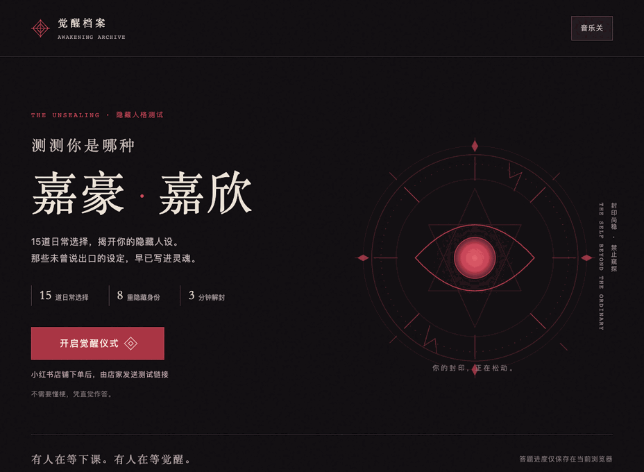
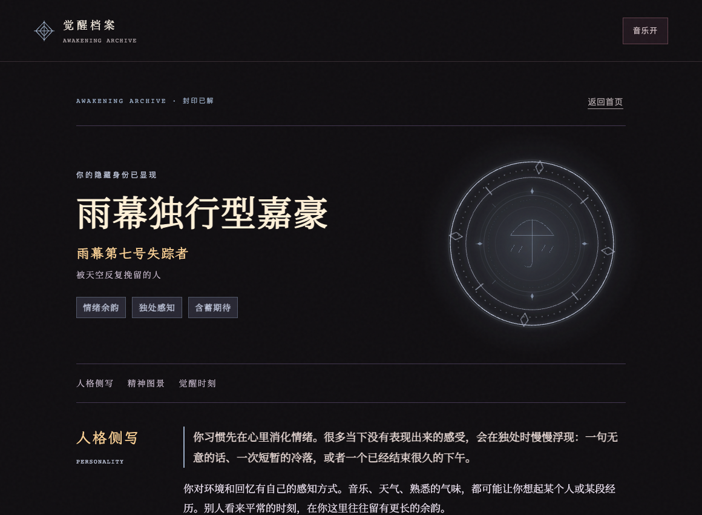

# 觉醒档案 · 测测你是哪种嘉豪／嘉欣

一个面向喜欢玩网络梗、看中二小剧场，或想和朋友交换测试结果的人做的网页趣味测试。回答 15 道日常情境题，就能解锁 8 种虚构身份中的一种，读到自己的角色档案，还可以保存身份卡。

## 为什么做

「嘉豪」「嘉欣」让我想到那些看起来很平常、脑内却已经演到大结局的瞬间。我想把这个梗做成一个不需要做功课的小游戏：从日常反应出发，把平时很难形容的一面写成夸张的人设和一段中二小剧场。朋友可以把身份卡发给彼此，看看哪一段最像自己。

## 能做什么

- **凭直觉答题。** 点选最像自己第一反应的选项，就会自动进入下一题。可以返回修改，也可以暂存，稍后用同一浏览器继续。
- **解封角色档案。** 答完会看到带有发光法阵的身份揭晓，以及人格侧写、精神图景、觉醒时刻、专属信物、命定禁语和灵魂铭文。角色名与玩家性别无关。
- **保存身份卡。** 在结果页点「保存身份卡」，就能下载图片发给朋友。也可以从首页查看上次的档案。

## 从开始到解封

1. 在首页点「开启觉醒仪式」。
2. 根据第一反应完成 15 道题，最后一题选完后自动揭晓身份。
3. 在结果页先看身份名和人格侧写，再点「觉醒时刻」跳到角色小剧场。

下方动图使用虚构作答，从首页走完 15 题并打开结果章节。为便于观看，缩短了读题停留时间。测试结果仅供娱乐。

## 结果页截图

